<i>Estudante de desenvolvimento, focado em Front-end para Web</i>

## <picture><source media="(prefers-color-scheme: dark)" srcset="assets/h-sobre.svg"></picture>

Tenho curso técnico no Senac, atualmente estudo na Fatec de São José do Rio Preto e faço estágio na Secretaria Municipal de Saúde, onde desenvolvo sistemas de automação de tarefas e aplicações web para a gestão de funcionários.

Na faculdade, estudo Java, Estruturas de Dados, SQL Server e UX/UI. Meus projetos acadêmicos vão desde a criação de um ERP para uma empresa real até o desenvolvimento de um afinador de violão acessível para pessoas com deficiência visual.

- **Atualmente:** Focado no ecossistema Spring Boot e em acessibilidade no front-end.
- **Em andamento:** Criação de uma aplicação educacional inclusiva que detecta notas e acordes em tempo real, proporcionando uma experiência de aprendizado musical autônoma e acessível.

## <picture><source media="(prefers-color-scheme: dark)" srcset="assets/h-paisagens.svg"></picture>


## <picture><source media="(prefers-color-scheme: dark)" srcset="assets/h-projetos.svg"></picture>

*Clique para abrir cada projeto.*

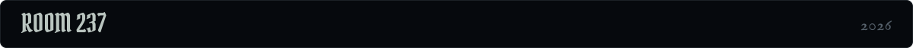

Um projeto web feito de fã para fã de cinema. Usando a API do The Movie Database (TMDB), você consegue buscar filmes específicos ou receber recomendações com base no que quer assistir.

`HTML` `CSS` `JavaScript`

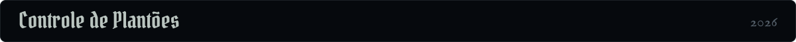

Gestão de plantões de servidores com três visões (funcionário, gerente e administrador), controle de acesso por perfil, dashboards e relatórios.

`PHP` `MySQL` `JavaScript`

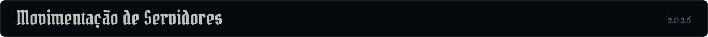

Sistema web para solicitar transferências de servidores entre unidades de saúde.

`HTML` `CSS` `JavaScript`

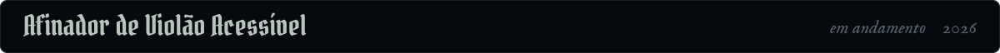

Aplicação web feita para pessoas com deficiência visual parcial ou total afinarem o violão.

`Java` `Spring Boot`

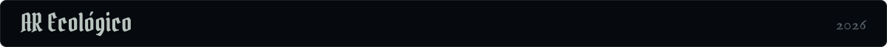

ERP web com arquitetura multipágina.

`Spring Boot` `Bootstrap`

## <picture><source media="(prefers-color-scheme: dark)" srcset="assets/h-registros.svg"></picture>

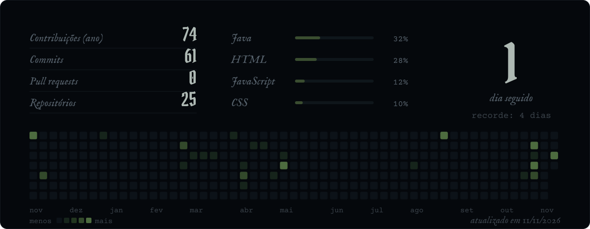

## <picture><source media="(prefers-color-scheme: dark)" srcset="assets/h-contato.svg"></picture>

Tem um projeto, uma vaga ou um bug que ninguém explica? Escreva.

<a href="mailto:gabrielriguetto3@gmail.com">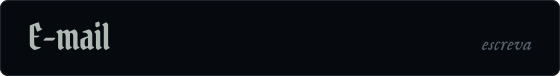</a>
<a href="https://linkedin.com/in/gabriel-fernandes-riguetto-5266b3351">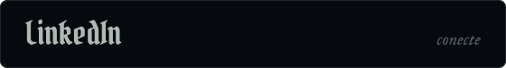</a>

